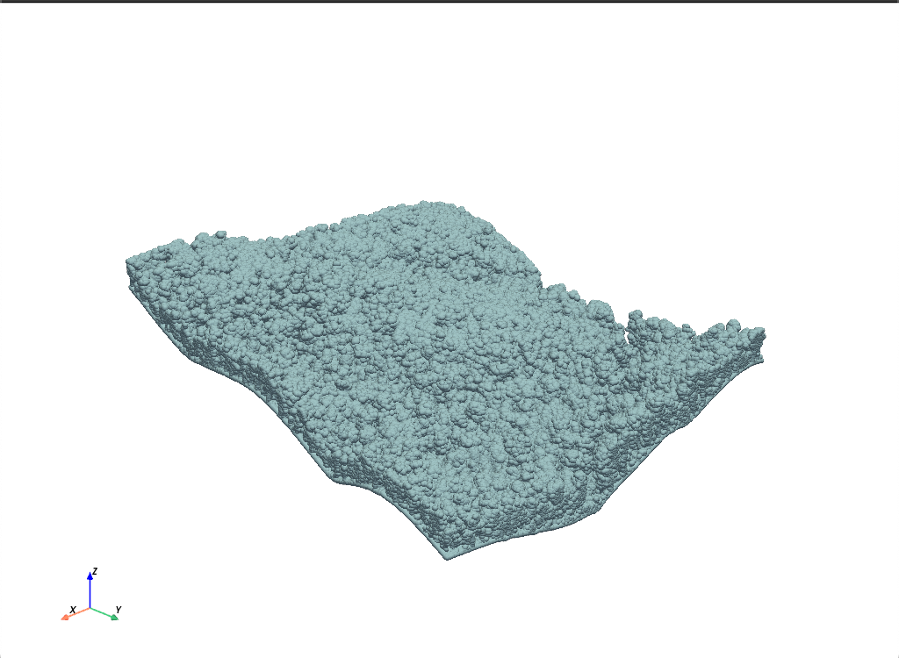
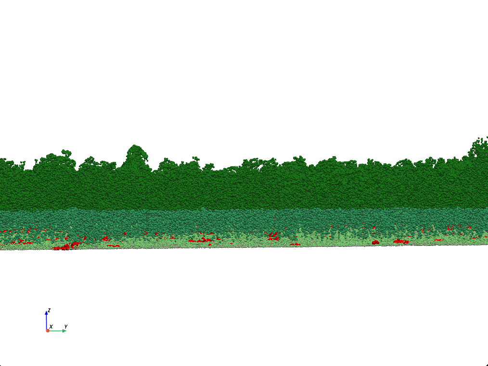
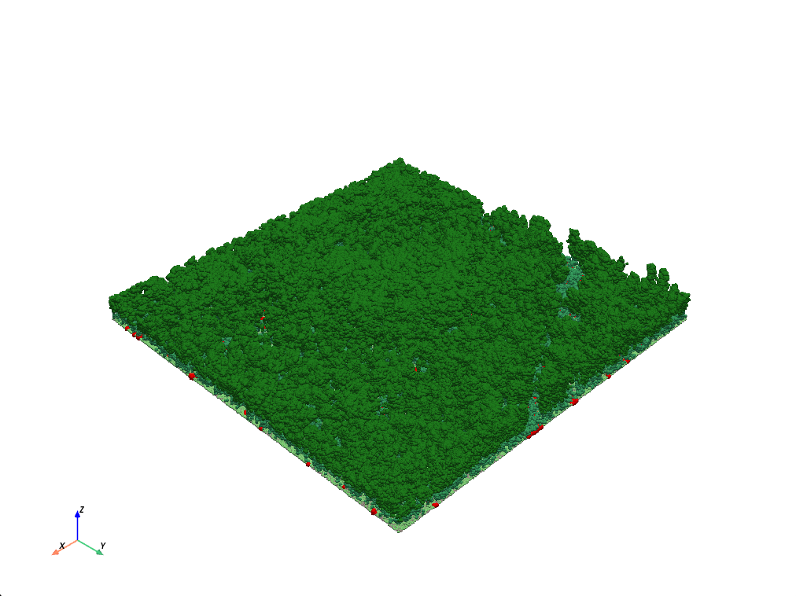
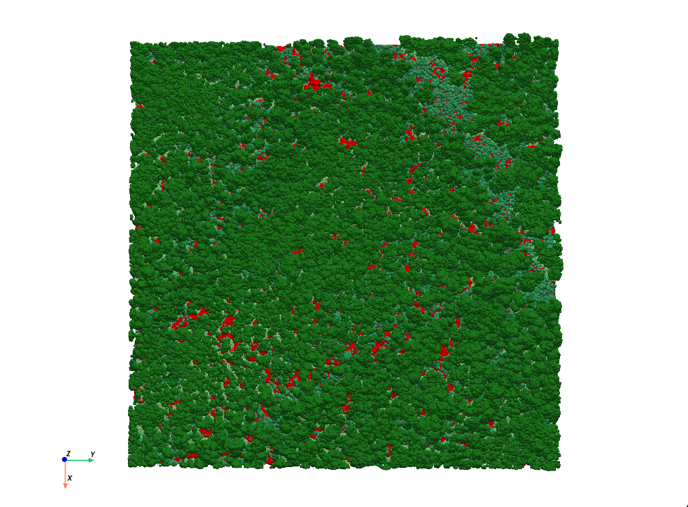

# Step 1: Data Ingestion & Validation
 To optimize memory, we extract the scaled X, Y, Z coordinates alongside the LAS classification codes, stacking them into a single 2D NumPy array. We then applied a random spatial mask to retain a representative sample of 2,000,000 points. Below is a visual of the original point cloud.

### Results
The resulting Z values range from ~644m to ~775m. This confirms the data represents absolute terrain elevation above sea level, not height above ground. The inclusion of the classification column will allow us to separate ground returns (Class 2) from vegetation returns in the normalization step.

# Step 2: Ground Normalization (Height Above Ground)
Airborne LiDAR captures absolute elevation (height above sea level). To accurately analyze forest structure, we must convert these elevations into Height Above Ground (HAG).
First separate the point cloud into ground returns (Class 2) and vegetation returns (Classes 3-5). Using a 2D scipy.spatial.KDTree built from the ground points' X and Y coordinates, we queried the nearest ground point for every vegetation point. By subtracting the nearest ground elevation from the vegetation elevation, we mathematically 'flatten' the terrain. The result is a normalized point cloud where Z=0 represents the forest floor, allowing for accurate vertical strata filtering in the next step.

### Results
Using a KDTree, we successfully matched every vegetation point to its nearest ground point in the horizontal plane and subtracted the ground elevation.
- **Max height**: 60.5m (consistent with tall Australian rainforests)
- **Mean height**: 18.7m (Realistic average canopy height)
- **Min height**: -1.5m (Minor negative values are expected due to micro-terrain dips)
  
The resulting veg_normalized.npy array now contains true Height above ground (HAG) values, ready for strata filtering.

# Step 3: Strata Filtering (Normalized Heights)
Using the Height above ground normalized vegetation data, we applied vertical strata filtering.
  
### Results
- **Understory** (0-2m): 224,698 points (16.8%)
- **Midstory** (2-15m): 198,085 points (14.8%)
- **Canopy** (>15m): 914,865 points (64.8%)

This distribution is consistent with a mature Australian forest, where the canopy layer dominates the point cloud, with substantial understory and midstory regeneration. See color mapped layers below

# Step 4: Canopy Gap Detection
To detect canopy gaps in ALS data we use a spatial proximity query. For every understory point, we query whether any canopy points exist within a 2.5 metre horizontal radius. We then build a KDTree from the canopy points' X, Y coordinates, then query it using the understory points' X and Y coordinates. If an understory point returns zero canopy neighbors within the 4m radius, it indicates that there is no canopy cover directly above that location. These understory points represent the physical boundaries of canopy gaps on the forest floor.

### Results
- **Total Understory Points** 224,698
- **Gap Boundary Points** 20,690 (9.2%)

This 9.2% canopy gap coverage is ecologically consistent with a mature Australian rainforest, where canopy gaps are scattered but not dominant. 

# Step 5: 3D Visualization & Validation
The final step integrates all processed data layers into an interactive 3D visualization using PyVista.

### Results
- **Normalized ground** (flat terrain at Z=0)
- **Understory vegetation** (0-2m, light green)
- **Midstory vegetation** (2-15m, medium green)
- **Canopy vegetation** (>15m, dark green)
- **Detected canopy gap boundaries** (red/yellow highlights)

Visual inspection confirms that the red gap boundary points locally cluster in areas of sparse or missing canopy cover, validating the spatial proximity query. See results below

# Step 6: Gap Metrics
Finally we calculate the physical area (in square meters) of detected canopy gaps using a convex hull algorithm. The convex hull algorithm computes the smallest convex polygon that encloses all gap boundary points, giving an estimate of the total gap area.

### Results
- **Total Gap Boundary Points**: 26,859
- **Calculated Gap Area**: 1,878.23 m²
- **Total Plot Area Analyzed**: 249,999.00 m² (25 hectares)
- **Gap Coverage**: 0.75% of the total plot area

